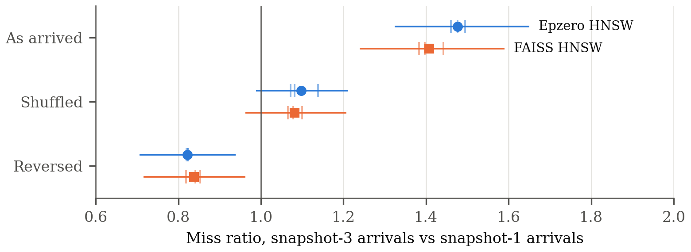

# Exploratory analyses after the held-out results (2026-11-20)

These analyses are **not** part of FINAL_PROTOCOL_V1. They were designed after the held-out
results were seen, and they describe the frozen evidence without changing it. The code is
`heldout_exploratory.py`. The outputs are in `build/longeval-heldout-exploratory-01/`
(`report.json`, `cohort-ratios.json`) and `build/longeval-development-order-01/`.

## 1. Newly inserted documents are under-retrieved by HNSW

Each document is assigned to the snapshot in which it first appears:

| Inserted at | Documents |
| --- | --- |
| Snapshot 1 | 869,902 |
| Snapshot 2 | 452,818 |
| Snapshot 3 | 339,180 |

For every exact top-100 neighbour of a test query, we record whether the ANN run returned it.
Newer documents could sit at different depths of the ranking, so misses are compared within
exact-rank bands: 1–10, 11–50 and 51–100. The *rank-standardized ratio* compares the misses
observed among documents inserted after snapshot 1 with the misses those documents would have
at the snapshot-1 cohort's rates in each band.

The intervals below come from a query bootstrap with 2,000 draws; seeds are pooled within each
query.

| Arm | Snapshot 2 | Snapshot 3 |
| --- | --- | --- |
| Epzero HNSW, incremental, ef 200 | 1.60 [1.45, 1.78] | 1.63 [1.49, 1.80] |
| FAISS HNSW, incremental, ef 200 | 1.54 [1.40, 1.70] | 1.54 [1.40, 1.69] |
| FAISS HNSW, incremental, calibrated | 1.52 [1.37, 1.71] | 1.56 [1.42, 1.72] |
| IVF, frozen training, calibrated | 1.17 [1.06, 1.30] | 1.17 [1.05, 1.29] |
| IVF, refreshed training, calibrated | 1.24 [1.13, 1.35] | 1.14 [1.03, 1.26] |

The raw rates show the same pattern. For Epzero at snapshot 3, ef 200, the miss rates in the
top-10 band are 2.7% for documents inserted at snapshot 1, 5.7% for snapshot 2 and 6.9% for
snapshot 3. For FAISS they are 2.4%, 6.0% and 7.0%.

### Insertion order or document property?

IVF has no insertion-order structure, so its ratio of about 1.15–1.25 estimates how much harder
the newer documents themselves are to retrieve. HNSW's excess is well above that.

The development evidence includes shuffled-order rebuilds, in which all documents are inserted
in a random order. The table gives the ratio on 50 development queries × 3 seeds at ef 200,
pooling every document inserted after snapshot 1, as in the held-out table:

| Arm | Snapshot 2, appended | Snapshot 2, shuffled | Snapshot 3, appended | Snapshot 3, shuffled |
| --- | --- | --- | --- | --- |
| Epzero | 1.66 | 1.08 | 1.21 | 1.11 |
| FAISS | 1.32 | 1.07 | 1.21 | 1.05 |

Shuffling lowers the ratio in all four comparisons, to 1.05–1.11, which is about the IVF level.
Most of the HNSW excess is therefore consistent with an **insertion-order effect**: in a graph
built by appending, documents inserted later are less reachable. The remainder, about 1.1, is a
property of the documents.

On the 50 development queries the appended-order excess at snapshot 3 (1.21) is smaller than on
the held-out queries (1.54–1.63). The development comparison is small, so a held-out
shuffled-order run is needed to confirm the mechanism (see "Improvements").

This is an aging mechanism that *maintenance* cannot remove. Incremental maintenance and an
identical-history rebuild are bit-identical (RQ1). Only a rebuild in a different order changes
it.

**Caveats.**
- This analysis is exploratory and was chosen after seeing the results.
- The development comparison is small: 50 queries, with 126–237 top-10 neighbours in the later
  cohorts.
- The ratio counts neighbour misses, not relevance.
- How much of the nDCG gap comes from new documents has not yet been measured.

## 2. What replaces a missed top-10 neighbour

These counts are pooled over seeds, on the primary panel of 374 queries with GPT-OSS-120B grades.
Unjudged documents count as grade 0.

| Arm (snapshot 3) | Dropped top-10 neighbours | Mean grade of dropped | Mean grade of replacement | Replacements that were judged | Mean grade of kept |
| --- | --- | --- | --- | --- | --- |
| Epzero, ef 200 | 399 | 1.01 | 0.22 | 18% | 1.54 |
| FAISS HNSW, ef 200 | 374 | 0.77 | 0.21 | 20% | 1.55 |
| FAISS HNSW, calibrated | 280 | 0.77 | 0.25 | 24% | 1.54 |
| IVF frozen, calibrated | 303 | 1.32 | 0.56 | 39% | 1.53 |

1. **Dropped neighbours are less relevant than the ones kept**, with mean grade 0.77–1.01
   against 1.54 for HNSW. Together with misses being rarer at the top of the ranking, this
   explains why the nDCG@10 gap (about 1%) is much smaller than the neighbour-recall shortfall
   (about 6%).
2. **Replacements are mostly unjudged.** Only 18–24% of HNSW replacements carry a judgment, and
   unjudged documents count as non-relevant. The organisers' overview says the LLM grades cover
   a depth-10 pool of the 24 systems submitted to Task 1 (CEUR Vol-4283, paper 374), so documents
   that only an approximate index returns were mostly never graded. The measured ANN gap is
   therefore partly a pooling artifact and is likely an upper bound on the true loss. The paper should state this. Judging a sample of the
   replacement documents would test it (see "Improvements").

## 3. Condensed-list check of the pooling bias

The condensed-list check removes unjudged documents from every ranking, exact and approximate,
before computing nDCG@10. Any unjudged substitute then counts neither for nor against a run. The
setup is the same as the primary analysis: 374 queries, seeds averaged within each query, and
the same inference settings.

| Arm (calibrated) | Gap at s1 | Gap at s2 | Gap at s3 | D [95% interval] | p |
| --- | --- | --- | --- | --- | --- |
| Epzero HNSW | −0.0008 | −0.0043 | −0.0056 | −0.0048 [−0.0116, +0.0003] | 0.112 |
| FAISS HNSW | −0.0012 | −0.0006 | −0.0007 | +0.0004 [−0.0031, +0.0039] | 0.824 |
| IVF, frozen | −0.0020 | −0.0020 | −0.0017 | +0.0003 [−0.0011, +0.0017] | 0.647 |

For comparison, the standard gaps at s1 are −0.0057, −0.0048 and −0.0065.

Removing unjudged documents shrinks the gap by roughly half to three-quarters (at snapshot 1:
from −0.005 to −0.006, down to −0.001 to −0.002). The ANN loss on judged documents is about
0.001–0.006 nDCG@10.

The pattern over time is unchanged:

- FAISS HNSW and IVF stay flat.
- Epzero's gap still widens, by −0.0048. Its interval just crosses −0.01, as in the primary
  analysis.

The computation is `heldout_exploratory.condensed_gaps`; its output is in
`build/longeval-heldout-exploratory-01/condensed.json`.

## 4. Does the new-document blind spot reach effectiveness?

The 374 primary-panel queries are split by the share of their exact top 10 at snapshot 3 that
was inserted after snapshot 1:

- **fresh:** 50% or more new, 77 queries;
- **old:** less than 50% new, 297 queries.

The table gives the snapshot-3 ANN-minus-exact nDCG@10 at the calibrated settings, with seeds
averaged within each query and a query bootstrap of 10,000 draws. The computation is
`heldout_exploratory.freshness_gaps`; the output is
`build/longeval-heldout-exploratory-01/freshness.json`.

| Arm | Fresh-content queries | Old-content queries |
| --- | --- | --- |
| Epzero HNSW (ef stayed at 200) | −0.0257 [−0.0549, −0.0056] | −0.0080 [−0.0131, −0.0035] |
| FAISS HNSW (ef rose to 400 for seeds 29 and 47) | −0.0081 [−0.0171, −0.0015] | −0.0048 [−0.0095, −0.0012] |
| IVF, frozen | −0.0097 [−0.0185, −0.0027] | −0.0076 [−0.0112, −0.0045] |

For the HNSW arm held at a fixed width, the average gap of about 0.01 hides a loss about three
times larger on queries whose answers are new content. A wider search (FAISS) and IVF shrink the
difference.

**Caveats.**
- The split is post hoc.
- The fresh group is small (77 queries), so its intervals are wide.
- New-content share is correlated with other query properties.

## 5. Held-out extension: shuffled order and ef sweep (jobs 7179544–7179549)

The six extension jobs all completed and their evidence checksums verify. The rebuilt incremental
arm reproduced every analysed primary run, and the incremental ef-200 sweep runs equal the
primary fixed-ef runs. All 216 sweep runs were recounted. The analysis is
`heldout_exploratory.extension`, with output in `build/longeval-heldout-extension-analysis-01/`.

**The insertion-order mechanism is confirmed on held-out queries.** The table gives the
rank-standardized miss ratio at ef 200 (2,000-draw query bootstrap):

| Arm | Snapshot 2, appended | Snapshot 2, shuffled | Snapshot 3, appended | Snapshot 3, shuffled |
| --- | --- | --- | --- | --- |
| Epzero | 1.60 [1.45, 1.78] | 1.13 [1.04, 1.23] | 1.63 [1.49, 1.80] | 1.25 [1.15, 1.35] |
| FAISS | 1.54 [1.40, 1.70] | 1.16 [1.07, 1.26] | 1.54 [1.40, 1.69] | 1.21 [1.11, 1.31] |

The shuffled ratios are close to IVF's (1.14–1.24).

**Reordering does not improve effectiveness.**
- Shuffled recall at ef 200 at snapshot 3 is 0.933, against 0.936 incremental.
- At ef 200, the shuffled gaps (s1/s2/s3) are −0.008/−0.011/−0.013 for Epzero and
  −0.007/−0.010/−0.011 for FAISS.
- With calibration, shuffled indexes needed ef 400 more often, and their calibrated D is about 0
  (Epzero +0.0011, FAISS +0.0009).

On the freshness split at ef 200 and snapshot 3:

| Arm | Fresh-content queries, incremental | Fresh-content queries, shuffled | Old-content queries, incremental | Old-content queries, shuffled |
| --- | --- | --- | --- | --- |
| Epzero | −0.026 | −0.024 | −0.008 | −0.011 |
| FAISS | −0.009 | −0.017 | −0.006 | −0.010 |

Reordering spreads the misses evenly across document ages; it does not remove them.

**ef sweep (incremental).** Mean recall and gap, s1 → s3:

| ef | Epzero recall | Epzero gap | FAISS recall | FAISS gap |
| --- | --- | --- | --- | --- |
| 100 | 0.900 → 0.885 | −0.010 → −0.023 | 0.902 → 0.892 | −0.011 → −0.015 |
| 200 | 0.947 → 0.936 | −0.006 → −0.012 | 0.946 → 0.938 | −0.005 → −0.007 |
| 400 | 0.969 → 0.964 | −0.003 → −0.005 | 0.969 → 0.964 | −0.003 → −0.005 |
| 800 | 0.982 → 0.979 | −0.002 → −0.003 | 0.982 → 0.978 | −0.002 → −0.003 |
| 1,600 | 0.988 → 0.986 | −0.001 → −0.001 | 0.988 → 0.985 | −0.001 → −0.001 |
| 3,200 | 0.994 → 0.991 | −0.000 → −0.000 | 0.993 → 0.991 | 0.000 → −0.000 |

Above about 98% recall the gap is small, and growth no longer changes it.

**Timing (jobs 7178503–7178505; secondary outcome of the protocol).** These are native
single-query results on the 381 test queries, as the mean of per-query medians:

| Index and setting | Latency | Distance work |
| --- | --- | --- |
| Epzero, ef 200 | 2.53 → 2.66 ms (p95 3.5–3.6 ms) | 2,672 → 2,754 computations |
| FAISS, ef 200 | 2.34 → 2.44 ms | 2,720 → 2,806 (native ndis) |
| FAISS, calibrated ef 400 (snapshots 2–3) | 3.9 ms | 4,300 |
| HNSW, ef 3,200 | 31–32 ms | about 30,000 |
| IVF at the calibrated nprobe 128 (primary jobs) | 129 → 184 ms | 160k → 228k comparisons |
| IVF at the frozen snapshot-1 nprobe | up to 243 ms | 302k comparisons |

## 6. External validation: the official baseline and its leaderboard position

The code is `heldout_robustness.py`, with output in `build/longeval-heldout-robustness-02/`. The
official numbers come from the extended overview of the CLEF 2026 LongEval lab (CEUR Vol-4283,
paper 374, Tables 3 and 4).

**Our exact search reproduces the organisers' dense baseline.** The table gives nDCG@10 over every
query that the label set judged at each snapshot:

| Labels | Ours (s1 / s2 / s3) | Official `baseline-qwen3-4b` | Largest difference |
| --- | --- | --- | --- |
| DCTR (149 / 97 / 135 queries) | 0.2334 / 0.2015 / 0.1330 | 0.234 / 0.201 / 0.133 | 0.0006 |
| GPT-OSS-120B (381 queries) | 0.7896 / 0.7953 / 0.7989 | 0.791 / 0.796 / 0.800 | 0.0014 |

The overview states 100 and 136 DCTR queries for snapshots 2 and 3, but the released files contain
97 and 135.

**Definitions.** The official run is `baseline-qwen3-4b`. The population is every query with a
judgment in that label set at that snapshot, taken from the released test judgments (DCTR click
labels and GPT-OSS-120B grades); unjudged documents count as grade 0. Our values are rounded to
four decimals and the published ones have three; the difference is taken against the published
three-decimal value. In the comparison below the other 21 leaderboard entries keep their published
values, so the ranks are a counterfactual about this one entry only.

**Would an approximate index have changed the official results?** The table places the baseline,
served through each index, among the 21 other official systems. Values are means over three seeds,
and all three seeds give the same ranks.

| Index | DCTR rank (s1 / s2 / s3) | DCTR difference from exact | GPT-OSS-120B rank | GPT-OSS-120B difference from exact |
| --- | --- | --- | --- | --- |
| Exact (official) | 16 / 20 / 18 | — | 5 / 5 / 5 | — |
| Epzero HNSW, ef 200 | 16 / 20 / **19** | −0.003 / −0.003 / −0.002 | 5 / 5 / 5 | −0.006 / −0.010 / −0.012 |
| FAISS HNSW, ef 200 | 16 / 20 / 18 | −0.003 / −0.004 / 0.000 | 5 / 5 / 5 | −0.005 / −0.006 / −0.008 |
| FAISS HNSW, calibrated | 16 / 20 / 18 | −0.003 / −0.003 / 0.000 | 5 / 5 / 5 | −0.005 / −0.005 / −0.006 |
| IVF frozen, calibrated | 16 / 20 / **19** | −0.003 / −0.001 / −0.006 | 5 / 5 / 5 | −0.006 / −0.008 / −0.009 |

The lab's robustness measure is the Relative Change, RC = (nDCG at snapshot 1 − nDCG at snapshot
t) / nDCG at snapshot 1. On DCTR, as in the overview's Table 4:

| Index | RC at snapshot 2 | RC at snapshot 3 |
| --- | --- | --- |
| Exact (ours; the overview reports 0.139 and 0.432) | 0.136 | 0.430 |
| Epzero HNSW, ef 200 | 0.139 | 0.432 |
| FAISS HNSW, ef 200 | 0.141 | 0.422 |
| FAISS HNSW, calibrated | 0.135 | 0.422 |
| IVF frozen, calibrated | 0.128 | 0.449 |

The index changes the baseline's RC by at most 0.02. Across the official systems at snapshot 3, RC
ranges from 0.17 to 0.56 for all but two outliers. The leaderboard rank changes in one case only:
at snapshot 3 on DCTR, where four systems sit within 0.002 of each other, the baseline drops one
place under two of the four indexes. At about 95% neighbour recall, the lab's published
conclusions about this baseline would therefore not have changed.

## 7. Where the loss sits: the per-query distribution

These figures use the primary panel of 374 queries with GPT-OSS-120B labels, with seeds averaged
within each query. The per-query means equal the primary gaps exactly.

| Index, snapshot 3 | Mean gap | Queries with identical nDCG@10 | Queries losing more than 0.05 | Queries losing more than 0.10 | Mean of the worst 5% | Share of the total loss from the worst 5% |
| --- | --- | --- | --- | --- | --- | --- |
| Epzero HNSW, ef 200 | −0.0117 | 85.3% | 7.0% | 2.9% | −0.218 | 81% |
| FAISS HNSW, ef 200 | −0.0069 | 87.4% | 6.1% | 2.1% | −0.141 | 80% |
| FAISS HNSW, calibrated | −0.0055 | 88.5% | 4.3% | 1.3% | −0.116 | 85% |
| IVF frozen, calibrated | −0.0080 | 82.1% | 5.1% | 2.4% | −0.123 | 71% |

At snapshot 1 the share of unaffected queries is 92% for HNSW; it falls to 85–89% by snapshot 3.
The average gap is therefore not a small loss spread over all queries. Most queries are untouched,
and a few lose a lot: the largest single-query loss is −0.87. A mean of about 0.01 understates
what an affected user sees.

**Definitions.** Every share uses the 374 panel queries as its denominator, for every arm. A query
counts as identical when its seed-averaged difference is zero. The worst 5% are the 18 queries
with the lowest difference (374 ÷ 20, rounded down). The last column divides the sum of their
differences by the sum of all negative differences, so queries that gain are not netted against
the loss.

## 8. Why a 50-query calibration missed the drift

**Sampling noise is enough to explain it.** Per-query neighbour recall at ef 200 has a standard
deviation of 0.11–0.12 on the test queries. A 50-query mean therefore has a standard error of
about 1.6 points, which is larger than the 1-point drift it has to detect.

The simulation below draws calibration sets from the test-query distribution (5,000 draws per
seed) and applies the protocol's rule: the smallest ef in {100, 200, 400, 800} whose mean recall
reaches 95%. It reports how often calibration stays at ef 200, although the true test recall there
is below the target.

| Calibration queries | Epzero, snapshot 3 (true recall 93.5%) | FAISS, snapshot 3 (true recall 93.6%) |
| --- | --- | --- |
| 25 | 32% | 32% |
| 50 (the protocol) | 21% | 22% |
| 100 | 11% | 12% |
| 200 | 4% | 4% |
| 400 | 1% | 1% |

A normal approximation gives 19% and 4% for 50 and 200 queries, which agrees with the simulation.
Detecting the drift with 95% probability needs about 200 calibration queries.

**Definitions.** Queries are drawn with replacement from the 381 test queries. Each draw is
applied to the incremental index of one seed at snapshot 3, and the outcome is averaged over the
three seeds. "Stays at ef 200" means that the rule selects ef 200, which is too narrow because the
true test recall there is below 95%. With 50 queries the rule selects ef 400 in 63% of draws for
Epzero (63% for FAISS), ef 800 in 15% (14%), and no width in 1% (1%).

**Testing the change instead of the level.** The same queries are searched at every snapshot, so a
monitor can test the per-query change in recall, which removes the variation between queries.
Recall at snapshots 1 and 3 is strongly correlated within a query (0.92 for Epzero, 0.95 for
FAISS). The change therefore has a standard deviation of 0.050 and 0.040, against 0.12 for the
level, and its standard error with 50 queries is 0.7 and 0.6 points instead of 1.6. That is still
not enough. The table gives how often a one-sided paired t-test at 5% detects the fall between
snapshots 1 and 3 (5,000 draws per seed from the test queries, averaged over seeds):

| Queries | Epzero (fall of 0.98 points) | FAISS (fall of 0.83 points) |
| --- | --- | --- |
| 25 | 35% | 33% |
| 50 | 51% | 51% |
| 100 | 73% | 73% |
| 200 | 89% | 90% |
| 400 | 96% | 98% |

Both views agree: 50 queries detect a one-point fall about half the time at best, about 200
queries are needed for 90%, and 400 for 95%. The standard deviation of the change differs between
seeds (Epzero: 0.043 / 0.071 / 0.036), so the figures are averages over the three indexes.

**A possible second cause, not established.** The 50 development queries score 1.0–2.4 points
higher recall than the test queries at the same ef 200, in all six backend × snapshot cells. With
50 queries this is not statistically reliable (permutation p from 0.13 to 0.55), so the paper
should not claim a shift between training and test queries.

**A safety margin instead of more queries.** The rule can also ask for more than the target:
choose the smallest ef whose calibration recall reaches 95% plus a margin. The table gives, for
calibration sets drawn from the test queries at snapshot 3, how often the chosen ef still falls
short of 95% on all test queries, with the mean chosen ef in brackets as the cost. The last column
is how often no ef up to 800 qualifies (Epzero; FAISS is within three points of it).

| Calibration queries | Margin (points) | Epzero: falls short (mean ef) | FAISS: falls short (mean ef) | No ef up to 800 qualifies |
| --- | --- | --- | --- | --- |
| 50 | 0.0 | 21% (416) | 22% (410) | 1.0% |
| 50 | 0.5 | 12% (469) | 13% (459) | 2.1% |
| 50 | 1.0 | 5.5% (522) | 6.0% (517) | 4.8% |
| 50 | 1.5 | 2.1% (575) | 1.9% (577) | 9.9% |
| 50 | 2.0 | 0.4% (636) | 0.5% (638) | 18% |
| 100 | 0.0 | 11% (413) | 12% (408) | 0.1% |
| 100 | 0.5 | 4.0% (466) | 4.3% (461) | 0.3% |
| 100 | 1.0 | 1.1% (532) | 1.1% (528) | 1.1% |
| 100 | 1.5 | 0.2% (616) | 0.2% (614) | 4.0% |
| 100 | 2.0 | 0.0% (696) | 0.0% (696) | 12% |
| 200 | 0.0 | 3.9% (405) | 4.1% (403) | 0.0% |
| 200 | 0.5 | 0.6% (446) | 0.8% (443) | 0.0% |
| 200 | 1.0 | 0.1% (523) | 0.1% (519) | 0.1% |
| 200 | 1.5 | 0.0% (640) | 0.0% (641) | 0.8% |
| 200 | 2.0 | 0.0% (743) | 0.0% (747) | 5.5% |

With the protocol's 50 queries, a one-point margin cuts the risk from 21% to 5.5% and raises the
mean width from 416 to 522. With 200 queries a half-point margin brings it to 0.6% at a mean width
of 446. Large margins on few queries are wasteful: at two points and 50 queries, 18% of
calibration sets find no width up to 800 good enough. The code is
`heldout_robustness.calibration_margin`.

## 9. The judging pool, and grades carried across snapshots

**The released LLM grades depend only on the query and the document.** In the released
GPT-OSS-120B labels, 32,917 query–document pairs appear at more than one snapshot, and none has
conflicting grades. The same holds for the GPT-OSS-20B labels. A grade can therefore be carried
from one snapshot to another, and new judging should be deduplicated by pair, not by snapshot.

**Size of the pool, on one ledger.** `heldout_pool.py` writes one ledger with a row for every
(query, document, snapshot) that appears in a top 10, and the rankings that returned it. The pool
is exact search plus every primary held-out run, at all seeds and snapshots. Two units are kept
apart:

- an **occurrence** is one ledger row, so a pair retrieved at three snapshots counts three times;
- a **pair** is a distinct query and document, which is the unit a judge is asked about.

| Quantity | All 381 test queries | Primary panel (374 queries) |
| --- | --- | --- |
| **Occurrences** (query, document, snapshot) in the pool | 12,561 | 12,317 |
| Unjudged at the snapshot where retrieved | 876 | 845 |
| — of those, graded by the organisers at another snapshot | 234 (2 / 95 / 137 at s1 / s2 / s3) | 222 (2 / 89 / 131) |
| — of those, never graded | 642 (227 / 204 / 211) | 623 (222 / 203 / 198) |
| **Distinct pairs** (query, document) in the pool | 5,511 | 5,383 |
| Graded by the organisers at some snapshot | 5,066 | 4,957 |
| Never graded at any snapshot | 445 | 426 |
| Pairs with at least one unjudged occurrence | 635 | 607 |
| — of those, fillable by carry-over | 190 | 181 |
| — of those, never graded | 445 | 426 |

Mind the units when quoting these figures: 635 and 190 are pairs, while 234 = 2 + 95 + 137 are
occurrences. The all-lists IVF setting adds no row to the ledger, because its top 10 never leaves
this pool.

**The exploratory runs more than double the judging work.** Adding the shuffled-order runs and the
ef sweep of section 5 grows the pool to 6,298 pairs, of which 1,138 were never graded (6,117 and
1,070 on the panel). A judge that fills the pool has 445 new pairs to grade for the primary arms,
and 1,138 if the exploratory arms are to be scored on the same footing.

**Carried-over grades.** Each pair that the organisers judged at another snapshot takes that
grade, and both the exact and the approximate rankings are rescored against the recomputed ideal
DCG. The panel is the primary 374 queries, with seeds averaged within each query.

| Arm (calibrated) | Gap s1 / s2 / s3, official labels | Gap s1 / s2 / s3, grades carried over |
| --- | --- | --- |
| Epzero HNSW | −0.0057 / −0.0102 / −0.0117 | −0.0055 / −0.0085 / −0.0089 |
| FAISS HNSW | −0.0048 / −0.0049 / −0.0055 | −0.0047 / −0.0043 / −0.0033 |
| IVF, frozen | −0.0065 / −0.0079 / −0.0080 | −0.0065 / −0.0055 / −0.0046 |

The carry-over removes a quarter to two-fifths of the snapshot-3 gap without any new judging. It
is lopsided, though: on the panel it adds 131 labels at snapshot 3, 89 at snapshot 2 and only 2 at
snapshot 1 (137 / 95 / 2 over all 381 queries). The change over time under carried grades is
therefore biased towards zero or positive values (Epzero −0.0034, FAISS +0.0015, IVF +0.0019) and
must not be read as a result. A full fill of the 445 never-graded pairs is needed for that.

**Coverage of the top 10.** Under the official labels, exact search has 99.6% / 99.5% / 99.5% of
its top-10 documents graded at snapshots 1 / 2 / 3, and Epzero has 97.6% / 97.0% / 96.6%. With
carried grades the figures are 99.7% / 99.8% / 99.9% and 97.7% / 98.0% / 98.2%.

**Sensitivity to the carrying rule.** The table carries a grade only to the occurrences in the
pool. Carrying it instead to every snapshot at which the document exists, whoever retrieved it,
adds 1,508 / 5,054 / 7,017 labels on the panel and moves no gap by more than 0.00012 (Epzero
−0.0055 / −0.0084 / −0.0090; FAISS −0.0047 / −0.0042 / −0.0033; IVF −0.0065 / −0.0055 / −0.0045).

The numbers were recomputed on 21 November 2026 from the verified held-out evidence with
`heldout_pool.py`; the official-label rows reproduce the primary analysis exactly. The output is
`build/longeval-heldout-pool-01/report.json`. The ledger itself holds query and document
identifiers and is not published.

## 10. Insertion-order pilot: reversing the order moves the blind spot

This is a mechanism pilot on a sample, run on a local machine on 20 November 2026. It is not a
result about the full collection. The code is `insertion_pilot.py`; the outputs are in
`build/longeval-insertion-pilot-01/` (FAISS) and `build/longeval-insertion-pilot-02-epzero/`.

**Setup.** A fixed sample of 300,000 snapshot-3 documents keeps each document's arrival snapshot
(156,741, 81,467 and 61,792 documents). Each HNSW index uses the study's settings (M 16,
efConstruction 100, inner product, one thread) and is searched at ef 200 with the 381 test
queries. Exact neighbours are computed inside the sample. Each index is built in three orders:

- **as arrived:** snapshot-1 documents first, in lexical ID order within each arrival group, as
  the collection grew;
- **reversed:** snapshot-3 documents first, then snapshot 2, then snapshot 1. Only the three
  blocks are reversed; lexical ID order is kept within each block;
- **shuffled:** one random permutation of all documents, seeded by the build seed, so both
  implementations insert the same sequence for a given seed.

The sample is the 300,000 documents with the smallest SHA-256 of a fixed prefix and the document
ID. The SHA-256 of the sampled ID list is recorded in the summary file below.

**Miss ratio.** The table gives the rank-standardized miss ratio of snapshot-3 arrivals against
snapshot-1 arrivals, with 95% query-bootstrap intervals (5,000 draws), for seeds 11 / 29 / 47:

| Implementation | As arrived | Shuffled | Reversed |
| --- | --- | --- | --- |
| FAISS HNSW | 1.40 / 1.44 / 1.38 | 1.10 / 1.08 / 1.07 | 0.82 / 0.84 / 0.85 |
| Epzero HNSW | 1.46 / 1.49 / 1.48 | 1.14 / 1.08 / 1.07 | 0.82 / 0.82 / 0.82 |

The as-arrived intervals all lie above 1 (lowest bound 1.22). The reversed intervals lie below 1
in five of the six builds; the sixth just includes 1 (FAISS, seed 47: [0.713, 1.003]). The shuffled
intervals include or touch 1 (bounds from 0.93 to 1.27).

**Counts behind the ratios.** Every build is scored on the same 38,100 exact neighbours (381
queries × 100): 22,022, 9,200 and 6,878 from the arrival groups of snapshots 1, 2 and 3. The table
gives the missed neighbours by arrival group, for seeds 11 / 29 / 47:

| Build | Snapshot-1 arrivals | Snapshot-2 arrivals | Snapshot-3 arrivals |
| --- | --- | --- | --- |
| FAISS, as arrived | 1,004 / 1,018 / 1,014 | 596 / 602 / 587 | 457 / 477 / 455 |
| FAISS, shuffled | 1,134 / 1,169 / 1,176 | 530 / 537 / 534 | 406 / 411 / 407 |
| FAISS, reversed | 1,256 / 1,270 / 1,187 | 546 / 538 / 519 | 334 / 347 / 331 |
| Epzero, as arrived | 991 / 998 / 1,028 | 604 / 596 / 615 | 472 / 487 / 494 |
| Epzero, shuffled | 1,156 / 1,181 / 1,180 | 551 / 541 / 563 | 427 / 417 / 411 |
| Epzero, reversed | 1,299 / 1,285 / 1,298 | 576 / 559 / 568 | 348 / 344 / 346 |

The ratio divides the observed misses of a later group by the misses expected if that group had
the snapshot-1 group's miss rate in each rank band (1–10, 11–50, 51–100). A band in which the
reference group has no exact neighbour would contribute no expected misses; this did not occur.
The counts by rank band, every ratio and the unrounded intervals of all 18 builds are in
[`insertion-pilot-summary.json`](insertion-pilot-summary.json), which holds aggregates only.

**Paired comparison of the orders.** Every build is resampled with the same query draws, so the
difference between two orders is paired. The table gives the mean over the three seeds with 95%
intervals:

| Implementation | Later group, against snapshot-1 arrivals | As arrived | Shuffled | Reversed | As arrived − reversed |
| --- | --- | --- | --- | --- | --- |
| FAISS | snapshot 3 | 1.41 [1.24, 1.59] | 1.08 [0.96, 1.21] | 0.84 [0.72, 0.96] | +0.57 [+0.45, +0.71] |
| FAISS | snapshot 2 | 1.36 [1.22, 1.51] | 1.06 [0.96, 1.17] | 0.99 [0.90, 1.09] | +0.36 [+0.24, +0.49] |
| FAISS | snapshots 2 and 3 together | 1.38 [1.25, 1.51] | 1.07 [0.97, 1.17] | 0.93 [0.84, 1.02] | +0.45 [+0.35, +0.56] |
| Epzero | snapshot 3 | 1.48 [1.32, 1.65] | 1.10 [0.99, 1.21] | 0.82 [0.71, 0.94] | +0.65 [+0.53, +0.80] |
| Epzero | snapshot 2 | 1.38 [1.25, 1.53] | 1.08 [0.99, 1.18] | 1.01 [0.91, 1.12] | +0.37 [+0.25, +0.50] |
| Epzero | snapshots 2 and 3 together | 1.42 [1.30, 1.56] | 1.09 [1.00, 1.18] | 0.93 [0.83, 1.03] | +0.49 [+0.39, +0.61] |

The difference is also above zero in each of the six builds: the lowest interval bound is +0.375
for snapshot-3 arrivals and +0.300 for snapshots 2 and 3 together. The upper bound of the reversed
snapshot-3 ratio, unrounded, is between 0.934 and 1.003; only FAISS seed 47 exceeds 1.

**The ratio of the pooled later group shrinks but does not reverse.** With "later" defined as snapshots 2 and 3
together, the reversed ratio is 0.92–0.94 and all six intervals include 1. The snapshot-2 group is
the middle block in both orders, so it dilutes the contrast: in the reversed builds its own ratio
is 0.98–1.02. A full-scale experiment that uses the pooled definition should expect a clear
reduction (+0.45 and +0.49 here) and no reversal. The reversal shows only between the two extreme
blocks.

*Mean over three seeds with 95% query-bootstrap intervals; the short ticks are the single seeds.
300,000-document sample, ef 200.*

**Incoming links.** Base-layer incoming links fall with insertion position in every order and in
both implementations: 28.1–29.4 for the first tenth of insertions, 11.9–14.5 for the last tenth.
By arrival group, in the as-arrived FAISS build the means are 23.0 / 17.0 / 14.9 for snapshots 1 /
2 / 3; in the reversed build they are 15.5 / 21.1 / 26.7. At most 0.02% of documents have no
incoming link, so later insertions are weakly connected, not unreachable.

**Recall.** Recall@100 is 0.942–0.947 in every order, so order redistributes misses without
removing them. This matches the held-out shuffled-order result in section 5.

**Other search widths and a denser graph.** All 18 builds were repeated and searched at ef 100,
200, 400 and 800, and then built again with a denser graph (M 32, efConstruction 200): 36 builds.
The rebuilt M 16 indexes reproduce the per-query misses of the first run exactly at ef 200, in all
18 builds. The table gives the miss ratio of snapshot-3 arrivals against snapshot-1 arrivals, as
the mean over three seeds with 95% intervals:

| Graph | Implementation | ef | Recall@100 | As arrived | Shuffled | Reversed | As arrived − reversed |
| --- | --- | --- | --- | --- | --- | --- | --- |
| M 16, efConstruction 100 | FAISS | 100 | 0.890–0.898 | 1.30 [1.19, 1.42] | 1.03 [0.95, 1.12] | 0.84 [0.75, 0.93] | +0.47 [+0.38, +0.56] |
| M 16, efConstruction 100 | FAISS | 200 | 0.943–0.947 | 1.41 [1.24, 1.59] | 1.08 [0.96, 1.21] | 0.84 [0.72, 0.96] | +0.57 [+0.45, +0.71] |
| M 16, efConstruction 100 | FAISS | 400 | 0.968–0.971 | 1.39 [1.21, 1.59] | 1.12 [0.98, 1.27] | 0.86 [0.72, 1.01] | +0.52 [+0.36, +0.72] |
| M 16, efConstruction 100 | FAISS | 800 | 0.983–0.985 | 1.49 [1.25, 1.79] | 1.08 [0.89, 1.27] | 0.69 [0.53, 0.85] | +0.80 [+0.55, +1.11] |
| M 16, efConstruction 100 | Epzero | 100 | 0.890–0.895 | 1.38 [1.28, 1.50] | 1.03 [0.96, 1.11] | 0.81 [0.73, 0.90] | +0.57 [+0.48, +0.67] |
| M 16, efConstruction 100 | Epzero | 200 | 0.942–0.946 | 1.48 [1.32, 1.65] | 1.10 [0.99, 1.21] | 0.82 [0.71, 0.94] | +0.65 [+0.53, +0.80] |
| M 16, efConstruction 100 | Epzero | 400 | 0.968–0.971 | 1.45 [1.26, 1.68] | 1.12 [0.98, 1.27] | 0.81 [0.68, 0.94] | +0.64 [+0.48, +0.84] |
| M 16, efConstruction 100 | Epzero | 800 | 0.983–0.985 | 1.58 [1.33, 1.88] | 1.08 [0.89, 1.28] | 0.73 [0.57, 0.90] | +0.85 [+0.61, +1.14] |
| M 32, efConstruction 200 | FAISS | 100 | 0.938–0.942 | 1.55 [1.39, 1.74] | 1.03 [0.93, 1.14] | 0.80 [0.70, 0.91] | +0.75 [+0.61, +0.92] |
| M 32, efConstruction 200 | FAISS | 200 | 0.972–0.973 | 1.69 [1.45, 1.97] | 1.13 [0.96, 1.31] | 0.71 [0.58, 0.85] | +0.98 [+0.79, +1.22] |
| M 32, efConstruction 200 | FAISS | 400 | 0.986–0.987 | 1.98 [1.61, 2.48] | 1.24 [1.00, 1.50] | 0.71 [0.51, 0.92] | +1.27 [+0.89, +1.76] |
| M 32, efConstruction 200 | FAISS | 800 | 0.993–0.994 | 2.14 [1.58, 2.91] | 1.14 [0.88, 1.42] | 0.60 [0.38, 0.85] | +1.54 [+1.01, +2.32] |
| M 32, efConstruction 200 | Epzero | 100 | 0.937–0.940 | 1.63 [1.46, 1.82] | 1.06 [0.94, 1.17] | 0.80 [0.70, 0.91] | +0.82 [+0.68, +0.99] |
| M 32, efConstruction 200 | Epzero | 200 | 0.971–0.973 | 1.75 [1.49, 2.05] | 1.13 [0.96, 1.30] | 0.72 [0.58, 0.86] | +1.03 [+0.82, +1.30] |
| M 32, efConstruction 200 | Epzero | 400 | 0.986–0.987 | 2.08 [1.68, 2.60] | 1.22 [0.99, 1.46] | 0.73 [0.53, 0.95] | +1.35 [+0.96, +1.86] |
| M 32, efConstruction 200 | Epzero | 800 | 0.993–0.994 | 2.22 [1.64, 3.02] | 1.08 [0.80, 1.37] | 0.59 [0.36, 0.85] | +1.63 [+1.11, +2.43] |

The pattern holds in all 16 rows. The as-arrived interval lies above 1 in every row, the reversed
ratio is below 1 in every row and its interval lies below 1 in 15 of 16, and the paired difference
is above zero in every row (lowest interval bound +0.36). The shuffled ratio stays between 1.03
and 1.24.

**A wider search or a denser graph removes misses but concentrates the rest.** The as-arrived
ratio is higher at ef 800 than at ef 200 for both implementations and both graphs, and higher with
the denser graph at every width: 1.30–1.58 at M 16 against 1.55–2.22 at M 32, with reversed ratios
of 0.69–0.86 and 0.59–0.80. In the denser graph the first tenth of insertions has 48–50 incoming
base-layer links and the last tenth 18–20. At high recall few misses remain, so the intervals
widen: at M 32 and ef 800 recall is above 0.99. The aggregates are in
[`insertion-pilot-robustness.json`](insertion-pilot-robustness.json).

**Reading.** The three ratios fit one account. Later documents are about 1.1 times harder to
retrieve in themselves (the shuffled ratio), and insertion position multiplies or divides that by
about 1.3. A practitioner report describes the opposite direction for an early small group
followed by a much larger batch (<https://github.com/chroma-core/chroma/issues/7963>), which is
why the reversed arm is the decisive test.

**Limits.**

- The sample is 18% of snapshot 3.
- The reversed arm has not been run at full scale. That is the confirming experiment.

## 11. The LLM grades against the released human grades

The release holds one more label file for snapshot 3, named `…-human.txt`: 1,581 grades on a 0–2
scale for 29 test queries. The frozen protocol uses it as a sensitivity family. This section
compares it with the LLM grades pair by pair. The code is `heldout_pool.human_agreement` and
`heldout_pool.human_label_provenance`; the output is `build/longeval-heldout-pool-02/report.json`,
computed on 21 November 2026 from the released judgments only.

**What the file is.** The overview of the lab does not say how this file was made, so its origin
is inferred here, not documented. It is not a copy of another released label set: among the 318
released LLM label files the best exact agreement is 54.3%, and it shares only 83 pairs with the
DCTR click labels. Every one of its pairs lies in the depth-10 pool that the LLMs graded for the
manually formalized topics (1,581 of 1,651 pairs at snapshot 3). It is read here as an independent
human assessment of those formalized topics.

| Measure, all 1,581 pairs | GPT-OSS-120B | GPT-OSS-20B |
| --- | --- | --- |
| Pairs graded relevant by the model (human: 60.4%) | 87.0% | 87.3% |
| Human grade 0, graded relevant by the model | 71.1% | 72.4% |
| Human grade above 0, graded 0 by the model | 2.6% | 2.8% |
| Binary agreement | 0.70 [0.62, 0.78] | 0.70 [0.62, 0.77] |
| Linear-weighted kappa | 0.24 [0.14, 0.36] | 0.21 [0.12, 0.32] |
| Exact-search nDCG@10 on the 29 queries (human: 0.564) | 0.930 | 0.944 |
| Correlation of per-query nDCG@10 with the human-label value | −0.04 | +0.12 |

Intervals are 95%, from a bootstrap that resamples queries (2,000 draws).

**The LLM grades are lenient.** The model grades 87.0% of these pairs as relevant, against 60.4%
for the human grades, and it grades 71.1% of the human non-relevant pairs as relevant (445 of
626). The overview says the same about its LLM assessors in general ("tend to over-label
relevance").

**Per-query effectiveness does not carry over.** Exact search scores 0.93 under the LLM grades and
0.56 under the human grades, and the two per-query values are uncorrelated (−0.04). With most
pooled documents graded relevant, nDCG@10 under the LLM grades sits near its ceiling and separates
rankings poorly.

**Two caveats.** The human grades assess a formalized topic with a description, while the LLM
grades used in this study assess the original query alone, and the scales differ (0–2 against
0–3). The comparison is therefore between two assessors with different information, on 29 queries
at one snapshot. It is not a clean test of the model.

**What this means for the study.**

- The label-free results (neighbour recall, misses by arrival group, insertion order) do not depend
  on any label set.
- The effectiveness gaps are small under every label family, including the human one (within
  ±0.0005 at snapshot 3, see HELDOUT_RESULTS.md). The human family has 29 queries and one snapshot,
  so it cannot confirm the change over time.
- Under lenient labels a substitute document costs little when it is graded and its full gain when
  it is not. In section 2 the graded replacements have a mean grade of about 1.2 (0.22 ÷ 0.18),
  above the 1.01 of the neighbours they replace. The measured gap is therefore driven mostly by
  coverage, which is what the judgment-coverage experiment tests.
- The paper should call the primary measure "effectiveness under the organisers' LLM labels", state
  that those labels are lenient, and not present it as ground truth.

## 12. The change in the gap at each search width

The primary analysis compares arms at their calibrated widths: ef 200 at every snapshot for
Epzero, and ef 200 or 400 for FAISS. That mixes the implementation with the width its calibration
happened to keep. This section holds the width fixed instead. It uses the held-out sweep of
section 5: every incrementally maintained index searched at each ef, on the 374 panel queries,
with seeds averaged within each query and the bootstrap and sign-randomization settings of the
primary analysis. The code is `heldout_robustness.change_by_width`; the output is
`build/longeval-heldout-robustness-03/report.json`.

| ef | Epzero: gap at s1 → s3 | Epzero: change [95%] | FAISS: gap at s1 → s3 | FAISS: change [95%] | Epzero change − FAISS change [95%] |
| --- | --- | --- | --- | --- | --- |
| 100 | −0.0101 → −0.0226 | −0.0125 [−0.0193, −0.0064] | −0.0109 → −0.0151 | −0.0042 [−0.0114, +0.0038] | −0.0083 [−0.0179, −0.0007], p 0.046 |
| 200 | −0.0057 → −0.0117 | −0.0059 [−0.0129, −0.0006] | −0.0048 → −0.0069 | −0.0022 [−0.0053, +0.0013] | −0.0038 [−0.0101, +0.0010], p 0.20 |
| 400 | −0.0027 → −0.0053 | −0.0026 [−0.0059, +0.0002] | −0.0028 → −0.0050 | −0.0022 [−0.0053, +0.0005] | −0.0005 [−0.0031, +0.0024], p 0.73 |
| 800 | −0.0019 → −0.0025 | −0.0006 [−0.0026, +0.0014] | −0.0020 → −0.0030 | −0.0010 [−0.0030, +0.0009] | +0.0004 [−0.0007, +0.0017], p 0.54 |
| 1,600 | −0.0009 → −0.0011 | −0.0002 [−0.0022, +0.0017] | −0.0007 → −0.0013 | −0.0006 [−0.0026, +0.0013] | +0.0003 [−0.0012, +0.0020], p 0.68 |
| 3,200 | −0.0003 → −0.0002 | +0.0001 [−0.0014, +0.0017] | +0.0000 → −0.0003 | −0.0003 [−0.0014, +0.0007] | +0.0004 [−0.0004, +0.0014], p 0.38 |

The ef 200 rows reproduce the frozen analysis exactly: Epzero's primary contrast and FAISS's
secondary fixed-width contrast.

**The change shrinks as the search widens.** At ef 100 the gap more than doubles for Epzero
(−0.0101 to −0.0226). From ef 400 on, the whole interval of the change lies within ±0.01 for both
implementations, and from ef 1,600 on the change is within 0.001 of zero.

**Epzero's inconclusive result follows from its width.** At ef 400, the width that FAISS's
calibration moved to, Epzero's change is −0.0026 [−0.0059, +0.0002], inside the margin. At the
same width the two implementations do not differ reliably: at ef 200 the difference of the changes
is −0.0038 [−0.0101, +0.0010] (p 0.20), and from ef 400 on it is at most 0.0005 in absolute value.
At ef 100 Epzero's change is larger (−0.0083 [−0.0179, −0.0007], p 0.046). That is one nominal
result among six widths and does not survive adjustment, so it is a pointer for a narrower search,
not a finding.

These are fixed-width diagnostics on the test queries, designed after the held-out results were
seen. They do not replace the frozen decision for the calibrated arms.
